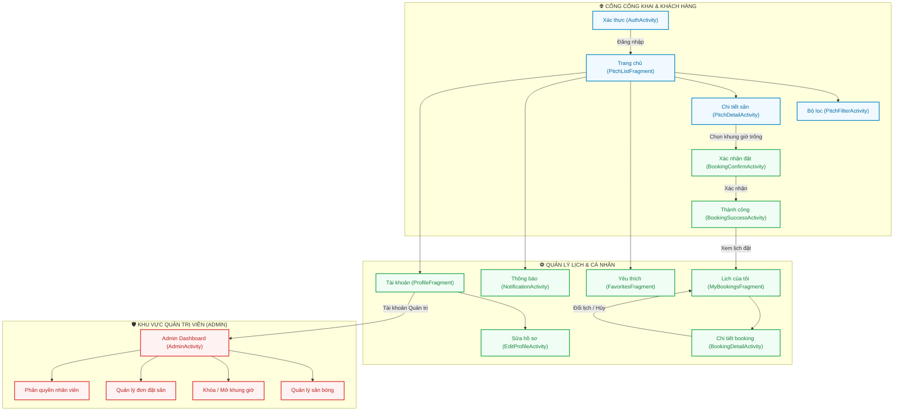

# AndZen — Ứng Dụng Đặt Sân Bóng Đá Android Native & Hệ Thống Quản Lý Sân

[-3DDC84?style=for-the-badge&logo=android&logoColor=white)](https://developer.android.com/)
[](https://openjdk.org/)
[](https://m3.material.io/)
[](https://fastapi.tiangolo.com/)
[](https://supabase.com/)
[](https://remixicon.com/)

---

## 🌟 Giới Thiệu Tổng Quan

**AndZen** là nền tảng di động Android Native hiện đại giúp người chơi bóng đá phong trào tìm kiếm sân bãi, kiểm tra khung giờ trống theo thời gian thực và đặt sân nhanh chóng chỉ trong vài thao tác chạm. Hệ thống tích hợp giải pháp quản trị sân bóng toàn diện dành cho chủ sân (Admin), bao gồm kiểm soát lịch đặt, phân quyền nhân viên và linh hoạt khóa/mở khung giờ hoạt động.

### Điểm nhấn nổi bật:
- 📱 **Trải nghiệm Android Native mượt mà**: Thiết kế theo chuẩn Google Material Design 3 với bảng màu Emerald Green thể thao, hệ thống 100% Vector Remix Icons đồng bộ.
- ⏱️ **Lọc khung giờ thông minh theo thời gian thực**: Tự động đánh dấu các ngày còn sân trống; lưới giờ chỉ hiển thị các slot hợp lệ, loại trừ khả năng xung đột hoặc đặt trùng lặp (Double Booking).
- 🔄 **Quản lý lịch đặt linh hoạt**: Hỗ trợ người dùng xem chi tiết đơn đặt, hủy lịch tự động giải phóng slot và đổi lịch (Reschedule) sang khung giờ mới trực tiếp trên app.
- 🛡️ **Quản trị sân đa phân quyền (Admin Workspace)**: Bảng điều khiển riêng cho chủ sân/nhân viên với 4 phân hệ: Quản lý sân, Quản lý khung giờ, Quản lý đơn đặt và Phân quyền nhân sự.
- ⚡ **Backend hiệu năng cao**: Xây dựng trên nền FastAPI (Python) bất đồng bộ, kết nối cơ sở dữ liệu Supabase PostgreSQL với cơ chế bảo mật Row-Level Security (RLS) chặt chẽ.

---

## 🗺️ Sơ Đồ Cấu Trúc Màn Hình & Điều Hướng (Site Map)

Hệ thống được tổ chức phân quyền rõ ràng theo mô hình **RBAC (Role-Based Access Control)** gồm 2 đối tượng chính: **Khách hàng đặt sân (Player / Customer)** và **Quản trị viên / Chủ sân (Admin / Staff)**.

### 1. Bảng Danh Mục Màn Hình & Phân Quyền

| STT | Màn hình / Activity | Tên chức năng | Phân quyền | Mô tả nghiệp vụ |
|:---:|:---|:---|:---:|:---|
| **I** | **CỔNG KHÁCH HÀNG (PLAYER PORTAL)** | | | |
| 1 | `AuthActivity` | Đăng nhập / Đăng ký | Public | Xác thực qua Email/SĐT hoặc Google, kiểm tra dữ liệu hợp lệ tức thì. |
| 2 | `MainActivity` | Màn hình chính (4 Tab) | Customer | Điều hướng Bottom Navigation: Tìm sân, Yêu thích, Lịch đặt, Tài khoản. |
| 3 | `PitchListFragment` | Danh sách sân bóng | Public | Tìm kiếm sân theo tên/khu vực, chip lọc nhanh sân 5/7/11, sân gần bạn. |
| 4 | `PitchFilterActivity` | Bộ lọc sân nâng cao | Public | Lọc đa chiều: Loại sân, Khoảng giá (Dưới 300k, 300k-500k, Trên 500k), Tiện ích (Đèn LED, Bãi xe, Căn tin, Áo bib). |
| 5 | `PitchDetailActivity` | Chi tiết sân & Chọn slot | Public | Thông tin sân, 4 ảnh thực tế, tiện ích, dải ngày & lưới khung giờ trống. |
| 6 | `BookingConfirmActivity` | Xác nhận đặt sân | Customer | Tóm tắt đơn giá, họ tên & SĐT người đặt, phương thức trả (Tiền mặt / QR). |
| 7 | `BookingSuccessActivity` | Đặt sân thành công | Customer | Thông báo thành công, mã đặt sân duy nhất (`SANBONG-XXXXXX`). |
| 8 | `FavoritesFragment` | Sân bóng yêu thích | Customer | Quản lý danh sách sân bóng yêu thích, đồng bộ 2 chiều với nút tim. |
| 9 | `MyBookingsFragment` | Quản lý lịch đặt | Customer | 3 tab phân loại: Sắp tới (Upcoming), Đã hoàn thành, Đã hủy. |
| 10 | `BookingDetailActivity` | Chi tiết đơn đặt sân | Customer | Xem mã đơn, trạng thái, thao tác Hủy lịch (dialog lý do) và Đổi lịch. |
| 11 | `ProfileFragment` | Hồ sơ cá nhân | Customer | Thống kê số trận, đổi thông tin, điều hướng vào khu vực Admin. |
| 12 | `EditProfileActivity` | Chỉnh sửa hồ sơ | Customer | Cập nhật họ tên, SĐT, email, địa chỉ, chọn ngày sinh & đổi avatar. |
| 13 | `NotificationActivity` | Trung tâm thông báo | Customer | Thông báo cập nhật đơn đặt sân, nhắc lịch thi đấu, tin khuyến mãi. |
| **II** | **CỔNG QUẢN TRỊ VIÊN (ADMIN WORKSPACE)** | | | *(Yêu cầu quyền Admin / Staff)* |
| 14 | `AdminActivity` | Bảng điều khiển quản trị | Admin/Staff | Giao diện quản lý tập trung dành riêng cho chủ sân và nhân viên vận hành. |
| 15 | `AdminPitchSection` | Quản lý danh mục sân | Admin | Danh sách sân, bật/tắt trạng thái hoạt động (Active/Inactive), sửa tiện ích. |
| 16 | `AdminSlotSection` | Quản lý khung giờ chơi | Admin/Staff | Lưới slot theo ngày của từng sân, thao tác Khóa (Lock) / Mở (Unlock) slot. |
| 17 | `AdminBookingSection` | Quản lý đơn đặt sân | Admin/Staff | Danh sách toàn bộ booking của khách, kiểm soát trạng thái, xử lý hủy/đổi. |
| 18 | `AdminStaffSection` | Phân quyền nhân viên | Admin | Quản lý danh sách nhân sự sân bóng, phân quyền tài khoản quản trị. |

---

### 2. Sơ Đồ Luồng Nghiệp Vụ (Navigation Flowchart)



---

## 🏗️ Kiến Trúc Kỹ Thuật (Architecture)

```
┌────────────────────────────────────────────────────────┐
│               ANDROID CLIENT (Java 17)                 │
│    Material Design 3 • Activities & Fragments <= 150L  │
│    Remix Icons (Vectors) • Secure Session Store        │
└───────────────────────────┬────────────────────────────┘
                            │ REST API / Bearer JWT Token
┌───────────────────────────▼────────────────────────────┐
│                    BACKEND (FastAPI)                   │
│    Python 3.11+ • Pydantic v2 • Async Uvicorn Server   │
│    Atomic Booking Lock • RBAC Security Middleware      │
└───────────────────────────┬────────────────────────────┘
                            │ PostgreSQL Protocol / REST
┌───────────────────────────▼────────────────────────────┐
│               DATABASE & AUTH (Supabase)               │
│    PostgreSQL Database • Row-Level Security (RLS)      │
│    Database Functions & Triggers • Schema Migrations   │
└────────────────────────────────────────────────────────┘
```

---

## 📸 Bộ Ảnh Chụp Màn Hình Minh Họa Ứng Dụng

Toàn bộ ảnh chụp dưới đây được ghi lại trực tiếp từ thiết bị Android Emulator thực tế của dự án:

### I. Cổng Đặt Sân & Trải Nghiệm Khách Hàng

#### 1. Trang Chủ / Tìm Kiếm Sân Bóng (`trangchu.png`)
*Thanh tìm kiếm thông minh, chip lọc nhanh sân 5/7/11, danh sách thẻ sân bóng kèm giá, tiện ích và đánh giá.*
<p align="center">
  
</p>

#### 2. Chi Tiết Sân Bóng & Chọn Khung Giờ (`chitietsan.png`)
*Hình ảnh sân thực tế sắc nét, danh sách tiện ích, dải ngày cuộn ngang tự động lọc ngày còn sân và lưới khung giờ trống.*
<p align="center">
  
</p>

#### 3. Xác Nhận Thông Tin & Thanh Toán (`xacnhandatsan.png`)
*Tóm tắt đơn đặt, nhập họ tên & số điện thoại người nhận sân, lựa chọn phương thức thanh toán linh hoạt.*
<p align="center">
  
</p>

#### 4. Đặt Sân Thành Công (`datsanthanhcong.png`)
*Thông báo đặt thành công kèm mã đặt sân độc nhất (`SANBONG-XXXXXX`), hỗ trợ điều hướng nhanh tới trang lịch.*
<p align="center">
  
</p>

---

### II. Quản Lý Đơn Đặt & Tài Khoản Cá Nhân

#### 5. Danh Sách Lịch Đã Đặt (`lichdadat.png`)
*Phân loại trực quan 3 trạng thái: Sắp tới (Upcoming), Đã hoàn thành (Completed) và Đã hủy (Cancelled).*
<p align="center">
  
</p>

#### 6. Chi Tiết Đơn Đặt Sân & Thao Tác Hủy/Đổi Lịch (`chitietsandadat.png`)
*Hiển thị đầy đủ thông tin trận đấu, hỗ trợ đổi lịch sang khung giờ mới hoặc hủy lịch kèm dialog xác nhận lý do.*
<p align="center">
  
</p>

#### 7. Hồ Sơ Cá Nhân & Thống Kê Trận Đấu (`profile.png`)
*Thông tin tài khoản, avatar, thống kê số trận đã tham gia, sân bóng yêu thích và lối vào khu vực Quản trị.*
<p align="center">
  
</p>

#### 8. Trung Tâm Thông Báo Hệ Thống (`thongbao.png`)
*Cập nhật trạng thái đơn đặt sân theo thời gian thực, nhắc nhở trước giờ bóng lăn và tin tức ưu đãi.*
<p align="center">
  
</p>

---

### III. Khu Vực Quản Trị Viên & Chủ Sân (Admin Portal)

#### 9. Bảng Điều Khiển Quản Lý Sân Bóng (`quanlysan.png`)
*Phân hệ dành riêng cho ban quản lý: kiểm soát danh mục sân, khóa/mở khung giờ, duyệt đơn đặt và quản lý nhân viên.*
<p align="center">
  
</p>

---

## 🛠️ Hướng Dẫn Cài Đặt Môi Trường & Khởi Chạy (Step-by-Step)

### 1. Yêu Cầu Tiên Quyết (Prerequisites)
- **Java**: JDK 17 (khuyên dùng OpenJDK 17).
- **Android Studio**: Android Studio Ladybug hoặc mới hơn, Android SDK 34/36.
- **Python**: Python 3.11+ (cho Backend FastAPI).
- **Thiết bị chạy**: Máy thật Android hoặc Android Virtual Device (Emulator API 24+).
- **Git** & **ADB**: Đã cấu hình biến môi trường `PATH`.

---

### 2. Thiết Lập & Khởi Chạy Backend (FastAPI + Supabase)

#### Bước 2.1: Chuẩn bị môi trường Python
Mở Terminal và di chuyển vào thư mục `backend/`:
```bash
cd backend
python -m venv .venv
```

Kích hoạt môi trường ảo:
- Trên Windows PowerShell:
  ```powershell
  .\.venv\Scripts\Activate.ps1
  ```
- Trên Linux / macOS:
  ```bash
  source .venv/bin/activate
  ```

Cài đặt các gói thư viện phụ thuộc:
```bash
pip install -r requirements.txt
```

#### Bước 2.2: Cấu hình biến môi trường Backend (`backend/.env`)
Sao chép từ file mẫu:
```bash
cp .env.example .env
```
Cấu hình nội dung `backend/.env`:
```env
SUPABASE_URL=https://your-project.supabase.co
SUPABASE_ANON_KEY=your-publishable-anon-key
SUPABASE_SERVICE_ROLE_KEY=your-service-role-key
PORT=8011
```

> ⚠️ **LƯU Ý BẢO MẬT:** `SUPABASE_SERVICE_ROLE_KEY` chỉ được đặt tại `backend/.env` phục vụ backend nghiệp vụ. **Tuyệt đối không đưa key này vào app Android Client**.

#### Bước 2.3: Khởi chạy máy chủ Backend
* **Cách 1: Khởi chạy tự động với ADB reverse (Khuyên dùng trên Windows)**:
  Script này tự động chuyển tiếp cổng kết nối từ Android Emulator và bật máy chủ Uvicorn:
  ```powershell
  powershell -ExecutionPolicy Bypass -File .\run-local.ps1
  ```
* **Cách 2: Khởi chạy thủ công bằng Uvicorn**:
  ```bash
  uvicorn app.main:app --host 127.0.0.1 --port 8011 --reload
  ```
  - **API Base URL:** `http://127.0.0.1:8011`
  - **Tài liệu Swagger OpenAPI:** `http://127.0.0.1:8011/docs`
  - **Kiểm tra Health:** `http://127.0.0.1:8011/health`

---

### 3. Thiết Lập & Khởi Chạy Ứng Dụng Android Native

#### Bước 3.1: Mở dự án trong Android Studio
1. Khởi động Android Studio.
2. Chọn **Open** và duyệt tới thư mục gốc của dự án `d:\AndZen`.
3. Chờ Gradle tải xong các thư viện và đồng bộ Version Catalog (`gradle/libs.versions.toml`).

#### Bước 3.2: Cấu hình `local.properties`
Tạo hoặc cập nhật file `local.properties` tại thư mục gốc của dự án:
```properties
sdk.dir=C\:\\Users\\<Ten_User>\\AppData\\Local\\Android\\Sdk
sanbong.supabaseUrl=https://your-project.supabase.co
sanbong.supabasePublishableKey=your-publishable-key
sanbong.apiBaseUrl=http://127.0.0.1:8000
```

#### Bước 3.3: Kết nối mạng giữa Android Emulator và Backend
Nếu khởi chạy backend thủ công bằng Uvicorn, chạy lệnh ADB reverse sau trong terminal:
```bash
adb reverse tcp:8000 tcp:8011
```
*(Lệnh này giúp ứng dụng Android khi gọi `http://127.0.0.1:8000` sẽ được định tuyến tự động tới máy chủ Backend port `8011` đang chạy trên máy tính).*

#### Bước 3.4: Biên dịch & Cài đặt lên thiết bị
- **Trong Android Studio**: Nhấn nút **Run** (biểu tượng Play xanh hoặc tổ hợp phím `Shift + F10`).
- **Hoặc qua dòng lệnh (Terminal)**:
  ```bash
  # Build bản Debug APK
  ./gradlew assembleDebug

  # Cài đặt trực tiếp lên Emulator / Thiết bị kết nối
  ./gradlew installDebug
  ```

---

### 4. Kiểm Thử Hệ Thống (Testing & QA)

| Tác vụ | Câu lệnh thực thi | Mô tả |
| :--- | :--- | :--- |
| **Unit Test Android** | `./gradlew test` | Kiểm thử tự động tính toán tiền tệ, định dạng ngày tháng và validate form. |
| **Kiểm thử hợp đồng Backend** | `python -m unittest tests/test_contracts.py` | Kiểm thử tự động các hợp đồng dữ liệu API của catalog, booking và admin. |
| **Kiểm thử luồng đặt sân QA** | `python backend/qa_booking_flow.py` | Kịch bản kiểm thử luồng tạo đơn, khóa slot, đổi giờ chơi và hủy sân. |
| **Đồng bộ Vector Icons** | `python tools/sync_admin_icons.py` | Script tiện ích kiểm tra và đồng bộ bộ icon Remix Icons cho giao diện. |

---

## 👥 Tài Khoản Kiểm Thử (Demo Accounts)

Tại màn hình đăng nhập (`AuthActivity`), bạn có thể sử dụng các tài khoản thử nghiệm sau:

| Vai trò | Tên người dùng | Email / SĐT đăng nhập | Mật khẩu | Quyền hạn truy cập |
| :--- | :--- | :--- | :---: | :--- |
| **Khách hàng đặt sân** | Nguyễn Văn An | `an.nguyen@email.com` / `0912345678` | `123456` | Đặt sân, hủy/đổi lịch, quản lý hồ sơ cá nhân. |
| **Nhân viên sân (Staff)** | Nhân Viên Trực Sân | `staff@sanbong.vn` / `0987654321` | `123456` | Xem đơn đặt, khóa/mở khung giờ chơi. |
| **Quản trị viên (Admin)** | Chủ Cụm Sân Hà Nội | `admin@sanbong.vn` / `0900000000` | `123456` | Toàn quyền quản trị sân, slot, đơn đặt và phân quyền nhân viên. |

---

## 📁 Cấu Trúc Thư Mục Dự Án (Directory Structure)

```
AndZen/
├── app/                                  # Ứng dụng Android Native (Client)
│   ├── src/main/java/com/sanbong/app/
│   │   ├── data/                         # ApiClient, AuthSession, Mappers, SecureSessionStore
│   │   ├── model/                        # Data Models (Pitch, TimeSlot, Booking, PitchType...)
│   │   ├── ui/                           # Activities & Sections (Quy chuẩn <= 150 dòng code)
│   │   │   ├── adapter/                  # Adapters hiển thị danh sách (Pitch, Slot, DateChip...)
│   │   │   └── AdminActivity.java        # Bảng điều khiển Quản trị viên
│   │   └── util/                         # Helpers (CurrencyUtils, DateTimeUtils, ValidationUtils)
│   └── src/main/res/                     # XML Layouts, Material Themes, 100% Vector Remix Icons
├── backend/                              # Máy chủ API nghiệp vụ FastAPI (Python)
│   ├── app/                              # Routers (catalog, bookings, account, admin), schemas
│   ├── supabase/migrations/              # Các file schema migration PostgreSQL, RLS, triggers
│   ├── tests/                            # Unit tests & API contract tests
│   ├── run-local.ps1                     # Script tự động hóa ADB reverse & chạy Uvicorn
│   └── requirements.txt                  # Danh sách thư viện Python
├── docs/                                 # Tài liệu kỹ thuật chuyên đề
│   ├── screenshots/                      # 9 ảnh chụp màn hình thực tế từ Android Emulator
│   ├── SITEMAP.md                        # Cây điều hướng màn hình & danh mục API endpoints
│   ├── SYSTEM.md                         # Kiến trúc hệ thống & coding rules
│   ├── PRODUCT_SPEC.md                   # Đặc tả nghiệp vụ & sản phẩm
│   ├── DESIGN_SYSTEM.md                  # Hệ thống thiết kế & tiêu chuẩn Remix Icons
│   └── README.md                         # Tài liệu tóm tắt dự án
├── tools/                                # Script tiện ích chụp màn hình adb & sync icon
├── .gitattributes                        # Cấu hình GitHub Linguist tập trung Java & Python
├── .gitignore                            # Cấu hình bỏ qua cache, build artifacts và file nhạy cảm
└── README.md                             # Tài liệu tổng quan & hướng dẫn chi tiết
```

---

## 📄 Bản Quyền & Giấy Phép
Dự án được xây dựng và phát triển phục vụ cộng đồng bóng đá phong trào Việt Nam. Mọi đóng góp xin vui lòng tạo Pull Request hoặc liên hệ ban phát triển **AndZen**.
