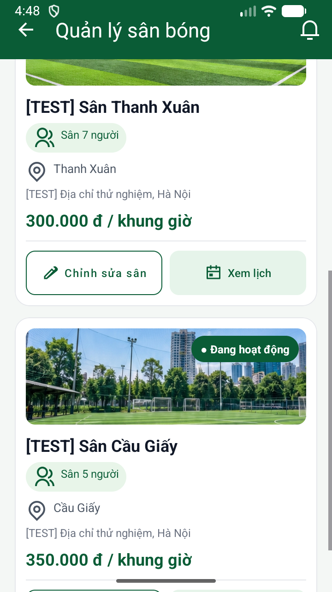
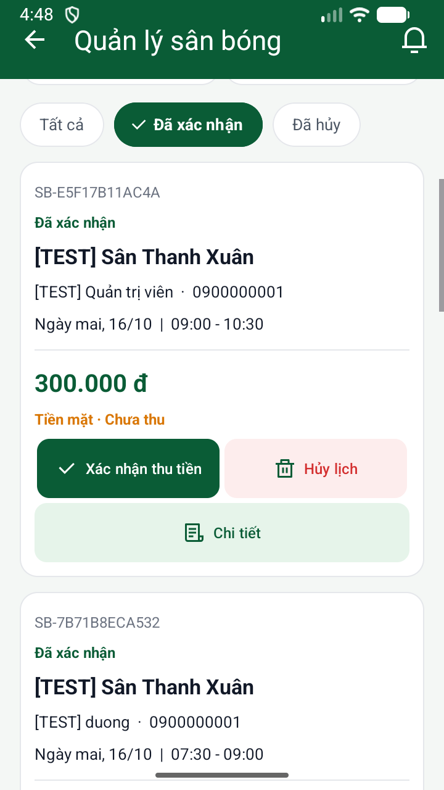
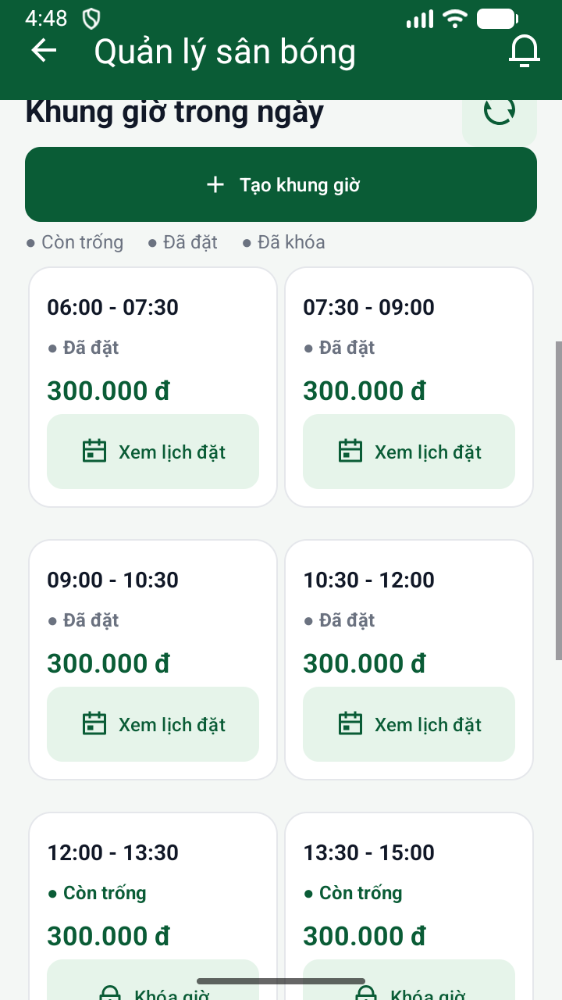
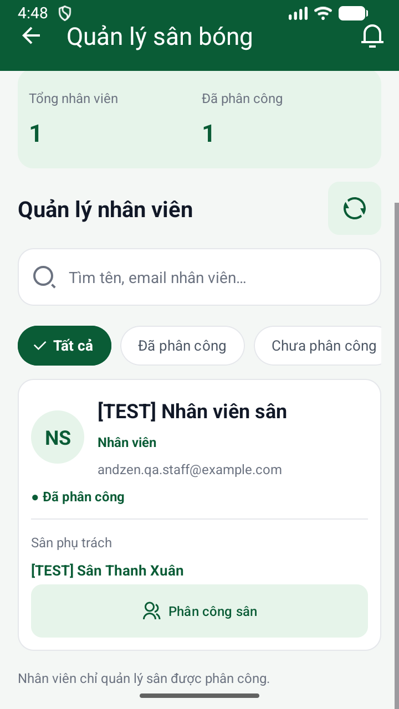

# Đối chiếu giao diện APK với ảnh mẫu

Ngày 15/10/2026. Thiết bị hiện có: **emulator-5554**, ảnh **720 × 1280**. Không có điện thoại USB kết nối tại thời điểm chụp.

Các ảnh trong `screenshots/` lấy trực tiếp bằng `adb exec-out screencap -p`, không chỉnh sửa ảnh. Mỗi tab có ảnh phần đầu (`*-top.png`) và phần nội dung sau khi cuộn (`*-content.png`). `capture.json` lưu nguồn và kích thước.

## Kết luận

**Đã đồng bộ thiết kế chung nhưng chưa giống hoàn toàn ảnh concept.**

| Mục | Đã khớp | Còn khác |
| --- | --- | --- |
| Sân bóng | Header/tab, màu xanh, thẻ ảnh, loại sân, nút sửa/xem lịch | Font, khoảng cách, chiều cao thẻ, ảnh sân lấy từ DB |
| Lịch đặt | Thống kê, tìm/lọc, trạng thái, giá và hành động | Concept chia thông tin khách/ngày/giờ thành hàng có icon; APK còn xếp dọc hơn. Trạng thái còn là chữ, chưa thành pill như mẫu. Nút Chi tiết xuất hiện trên mọi thẻ |
| Khung giờ | Chọn sân/ngày cùng một hàng, thống kê, lưới 2 cột, nút thao tác | Chú giải còn dùng chữ và chấm đơn sắc. Nút thêm giờ toàn chiều ngang |
| Nhân viên | Thống kê, bộ lọc, avatar chữ, sân phụ trách, phân công | Nút phân công nằm dưới và toàn chiều ngang; mẫu nằm cạnh thông tin sân. Khoảng cách và trạng thái còn khác |

Không chấm tỷ lệ phần trăm tương đồng khi chưa đo định lượng. Khác số lượng/tên/giờ giữa ảnh mẫu và APK không phải lỗi: APK đọc dữ liệu thật, ảnh mẫu dùng số minh họa.

### Điều chỉnh bộ lọc

Đã thay nút lọc dính liền thành chip bo tròn riêng biệt, cách nhau 8dp, trạng thái chọn có dấu tích. Ô chọn sân/ngày dùng nền trắng, viền nhẹ, nhãn và giá trị riêng, icon và mũi tên Remix Icon. Tên dài cho phép hai dòng; ngày trong màn Khung giờ hiển thị ngắn dạng dd/MM/yyyy. Ảnh trong thư mục screenshots được chụp lại từ bản APK sau thay đổi này.

## Icon

Đã thay icon làm mới cũ và bổ sung icon thao tác từ [Remix Icon chính thức](https://github.com/Remix-Design/RemixIcon): refresh-line, add-line, lock-line, lock-unlock-line, check-line, arrow-down-s-line và file-list-3-line. Các icon calendar/group/delete hiện có được tái sử dụng. Nguồn và commit được lưu ở `remixicon-sources.json`.

## Ảnh trực tiếp từ APK

| Sân bóng | Lịch đặt | Khung giờ | Nhân viên |
| --- | --- | --- | --- |
|  |  |  |  |

APK đã build và cài thành công trên máy giả lập: `app/build/outputs/apk/debug/app-debug.apk`. Lượt này chụp và đối chiếu UI; không ghi dữ liệu nghiệp vụ.
