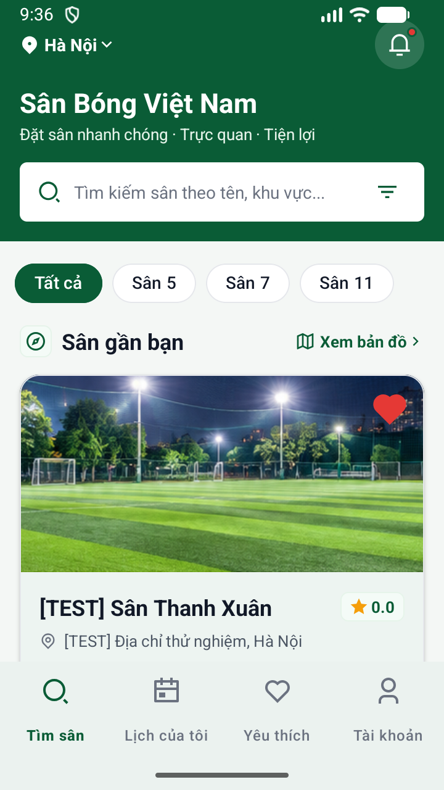
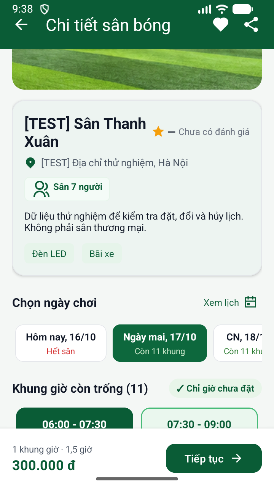
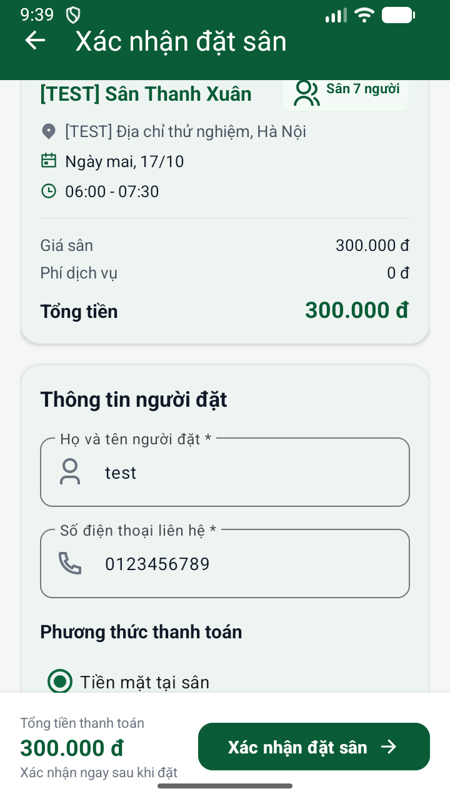
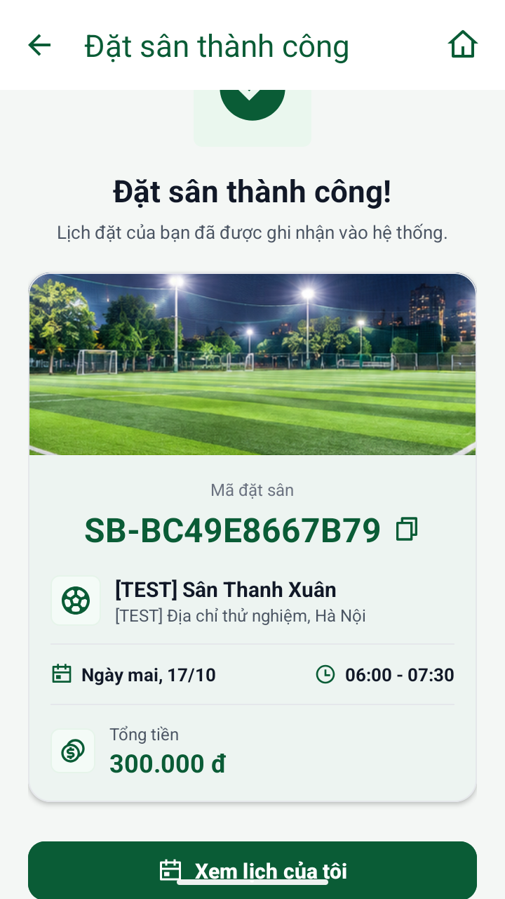
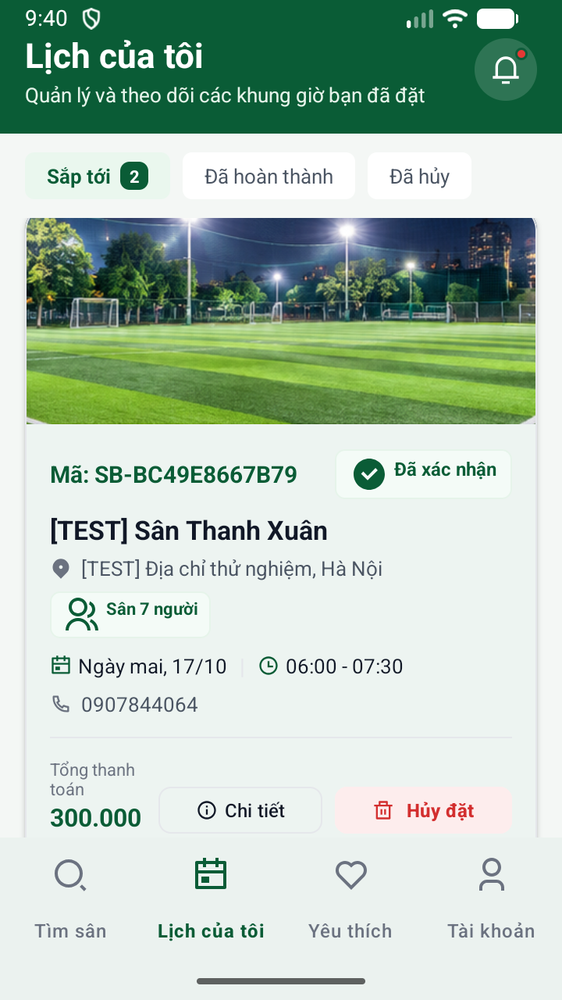
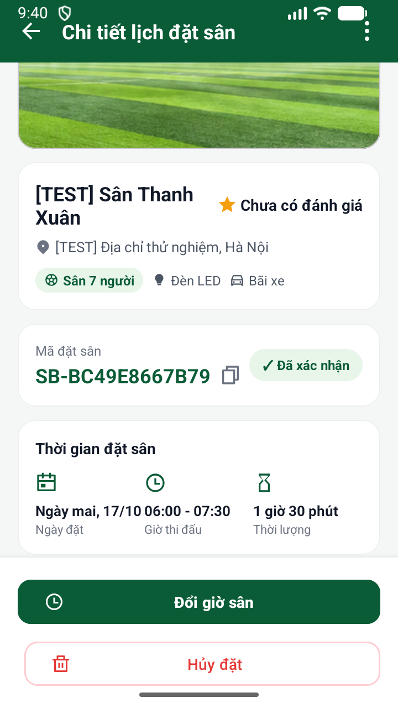
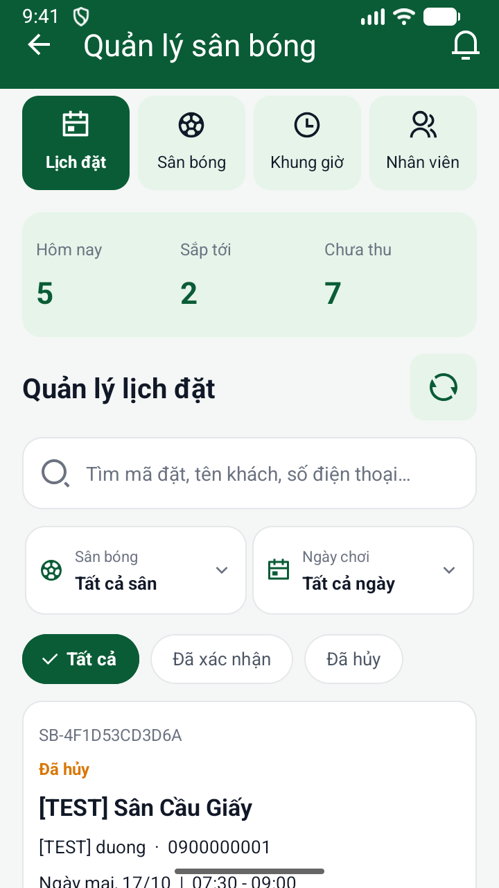
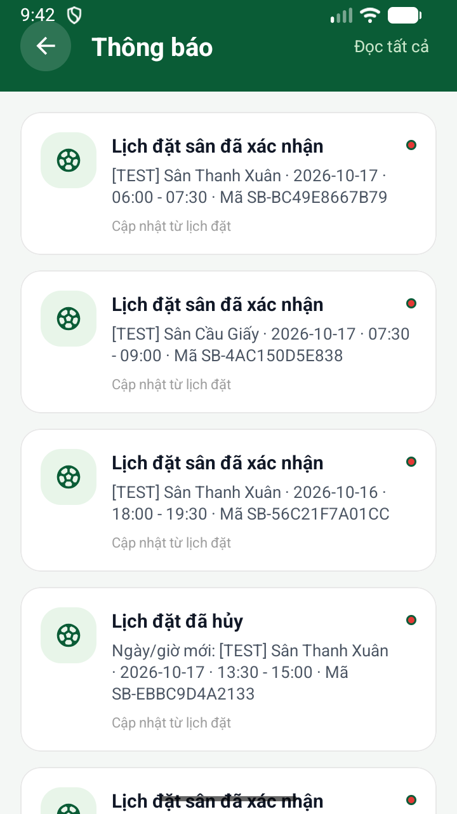
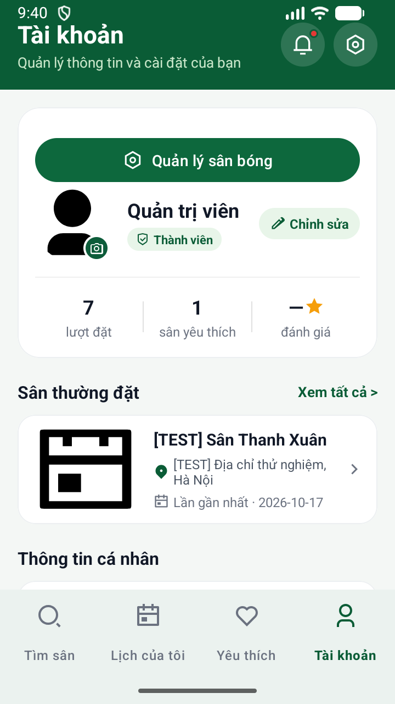

# Sân Bóng (AndZen) — Tài liệu dự án & Hướng dẫn cài đặt

Bộ tài liệu này phản ánh chi tiết kiến trúc, đặc tả tính năng, tiêu chuẩn giao diện và hướng dẫn thiết lập môi trường của ứng dụng Android Native đặt sân bóng **AndZen** (`com.sanbong.app`).

---

## 📱 Hình ảnh Giao diện Ứng dụng (App Screenshots)

Dưới đây là hình ảnh thực tế từng màn hình chức năng chính của ứng dụng được chụp trực tiếp từ Emulator:

| 1. Trang chủ / Tìm sân | 2. Chi tiết sân bóng | 3. Xác nhận đặt sân |
|:---:|:---:|:---:|
|  |  |  |
| **`trangchu.png`**<br/>Danh sách sân bóng, tìm kiếm, lọc nhanh sân 5/7/11 | **`chitietsan.png`**<br/>Thông tin tiện ích, chọn ngày & lưới khung giờ trống | **`xacnhandatsan.png`**<br/>Tóm tắt đơn, thông tin người nhận, hình thức thanh toán |

| 4. Đặt sân thành công | 5. Danh sách lịch đã đặt | 6. Chi tiết đơn đã đặt |
|:---:|:---:|:---:|
|  |  |  |
| **`datsanthanhcong.png`**<br/>Thông báo thành công, mã đặt sân duy nhất | **`lichdadat.png`**<br/>Phân loại Sắp tới / Đã xong / Đã hủy | **`chitietsandadat.png`**<br/>Chi tiết booking, hỗ trợ đổi lịch & hủy sân |

| 7. Quản lý sân (Admin) | 8. Thông báo hệ thống | 9. Hồ sơ cá nhân |
|:---:|:---:|:---:|
|  |  |  |
| **`quanlysan.png`**<br/>Quản trị danh mục sân, khóa/mở khung giờ chơi | **`thongbao.png`**<br/>Thông báo cập nhật đơn đặt, nhắc giờ thi đấu | **`profile.png`**<br/>Thông tin tài khoản, thống kê số trận & sân thích |

---

## 🚀 Hướng Dẫn Cài Đặt Môi Trường & Khởi Chạy

### 1. Chuẩn bị môi trường
- **JDK 17** (Cấu hình biến môi trường `JAVA_HOME`).
- **Android Studio** (kèm Android SDK 34/36 và Emulator).
- **Python 3.11+** (cho Backend FastAPI).
- **Git** và **ADB** sẵn sàng trong `PATH`.

### 2. Khởi chạy Backend
```bash
cd backend
python -m venv .venv

# Kích hoạt trên Windows PowerShell:
.\.venv\Scripts\Activate.ps1

# Cài đặt thư viện:
pip install -r requirements.txt

# Khởi chạy tự động với ADB reverse:
powershell -ExecutionPolicy Bypass -File .\run-local.ps1
```

### 3. Khởi chạy Android App
1. Mở dự án `AndZen` trong Android Studio.
2. Kiểm tra file `local.properties`:
   ```properties
   sdk.dir=C\:\\Users\\...\\AppData\\Local\\Android\\Sdk
   sanbong.apiBaseUrl=http://127.0.0.1:8000
   sanbong.supabaseUrl=https://your-project.supabase.co
   sanbong.supabasePublishableKey=your-key
   ```
3. Chạy lệnh forward cổng (nếu chưa chạy qua `run-local.ps1`):
   ```bash
   adb reverse tcp:8000 tcp:8011
   ```
4. Nhấn **Run** trên Android Studio hoặc chạy:
   ```bash
   ./gradlew installDebug
   ```

---

## 📚 Danh mục tài liệu kỹ thuật

- [SITEMAP.md](file:///d:/AndZen/docs/SITEMAP.md): Cấu trúc màn hình, Activity, Fragment, Dialog, Admin và danh mục API endpoints.
- [SYSTEM.md](file:///d:/AndZen/docs/SYSTEM.md): Kiến trúc hệ thống, công nghệ nền tảng và quy tắc phát triển (Java <= 150 dòng/controller).
- [PRODUCT_SPEC.md](file:///d:/AndZen/docs/PRODUCT_SPEC.md): Đặc tả tính năng, quy tắc nghiệp vụ và các luồng tương tác thực tế trong app.
- [COMPONENTS.md](file:///d:/AndZen/docs/COMPONENTS.md): Danh mục các Activity, Fragment, Adapter, Dialog và quy chuẩn giao diện.
- [DESIGN_SYSTEM.md](file:///d:/AndZen/docs/DESIGN_SYSTEM.md): Nguyên tắc giao diện, chuẩn Remix Icons đồng bộ và thành phần Material 3.
- [THEME.md](file:///d:/AndZen/docs/THEME.md): Bảng màu thương hiệu (Emerald Green `#10B981`, Dark Slate `#0F172A`), typography và shapes.
- [TYPOGRAPHY.md](file:///d:/AndZen/docs/TYPOGRAPHY.md): Quy chuẩn cỡ chữ, độ đậm và hierarchy trên Android.
- [RESPONSIVE.md](file:///d:/AndZen/docs/RESPONSIVE.md): Tương thích đa kích thước màn hình Android (Phone, Tablet, Cụm cuộn ngang).
- [TEST_PLAN.md](file:///d:/AndZen/docs/TEST_PLAN.md): Kịch bản kiểm thử đơn vị và nghiệm thu giao diện trên thiết bị thật.
